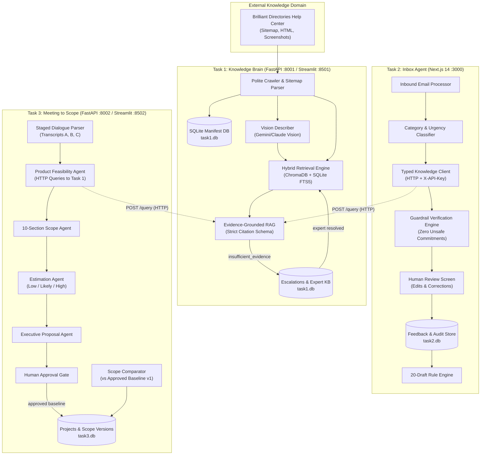
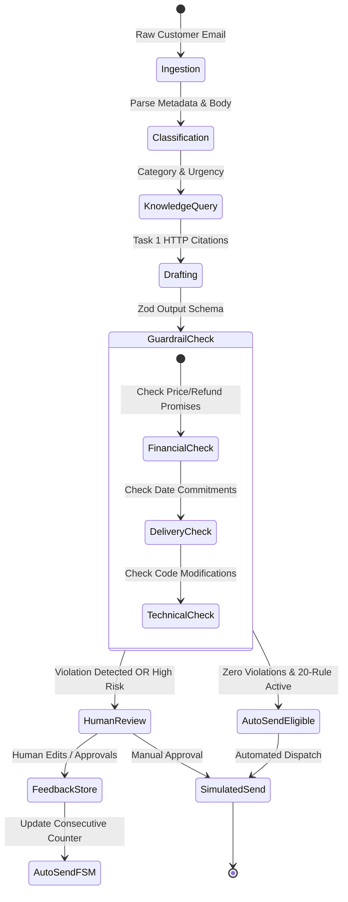
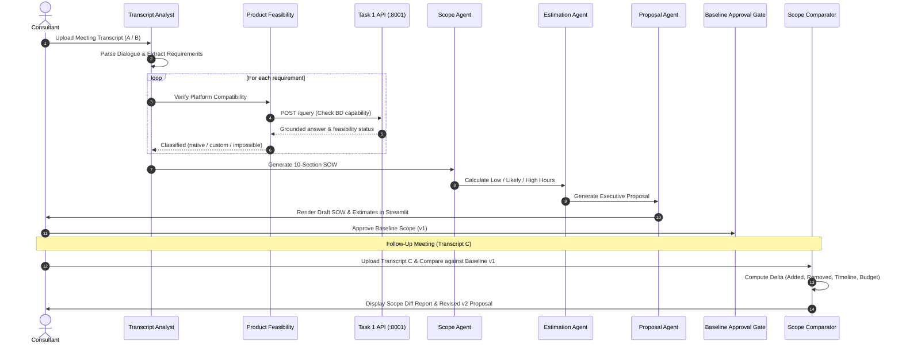

# System Design Document: AI Tech Consultant

> **Author:** Senior AI Engineer  
> **Status:** Approved / Production-Ready  
> **Target Platform:** Brilliant Directories Solution Center Automation  
> **Architecture Pattern:** Decoupled Autonomous Multi-App Microservices

---

## 1. Architectural Philosophy & System Topology

The **AI Tech Consultant** is an end-to-end enterprise solution addressing the operational bottleneck in custom software consulting: product knowledge retrieval, inbound technical support, and sales kickoff scoping.



### Strict Cross-App Decoupling
1. **Zero Shared Memory / Shared DB:** Task 1, Task 2, and Task 3 each operate isolated SQLite databases (`task1.db`, `task2.db`, and `task3.db`). No application ever accesses another application's disk storage.
2. **Standardized HTTP API Contract:** All cross-system operations traverse Task 1's REST API (`POST /query`) authenticated by an `X-API-Key` header.
3. **Graceful Degradation:** If Task 1 is unreachable or times out, Task 2 immediately renders a `"Knowledge service unavailable"` notice rather than hallucinating answers, while Task 3 marks technical feasibility as `"needs_clarification"` for human review.

---

## 2. Task 1: Knowledge Brain Architecture

### 2.1 Resumable Polite Crawler & Sitemap Engine
- **Sitemap Parser:** Fetches and streams XML sitemaps, extracting canonical URLs, `<lastmod>` timestamps, and change frequencies.
- **Manifest State Tracking:** The `crawler_manifest` table stores MD5 hashes of content, last crawl timestamps, and HTTP response codes. If a crawl is interrupted, re-running skips unchanged pages and resumes failed ones with exponential backoff.
- **Polite Crawling:** Enforces a configurable per-domain request delay (default 1.0s) and worker concurrency pool (default 2 workers) conforming to `robots.txt`.

### 2.2 Multimodal Screenshot Describer
- Extracts image tags from article content and downloads visual assets.
- Calls Gemini/Claude Vision models to transcribe UI buttons, admin menus, toggle states, and workflows.
- Visual summaries are embedded directly alongside surrounding paragraph context, allowing queries like *"Where is the API key field in General Settings?"* to succeed even if the text was only captured in a screenshot.

### 2.3 Hybrid Retrieval & Grounded RAG
```
Query ---> [Dense Vector Retrieval (ChromaDB MiniLM)] ---> Top-K Vector Chunks \
      ---> [Sparse BM25 Retrieval (SQLite FTS5)]      ---> Top-K Keyword Chunks ---> Reciprocal Rank Fusion ---> Strict RAG Prompt
```
- **Vector Search:** Uses local ONNX `sentence-transformers/all-MiniLM-L6-v2` generating 384-dimensional embeddings (100% free, zero cloud API rate limits).
- **Keyword Search:** Built using SQLite's native FTS5 engine, tokenizing technical identifiers, URLs, and code snippets.
- **Reciprocal Rank Fusion (RRF):** Merges dense and sparse ranks:
  $$\text{RRF Score}(d) = \sum_{m \in \{\text{dense}, \text{sparse}\}} \frac{1}{60 + r_m(d)}$$
- **Evidence-Only Prompting:** The RAG system operates under a strict system prompt forbidding speculation. If evidence similarity is below threshold $\tau = 0.55$, it returns status `insufficient_evidence`.
- **Human-in-the-Loop (HITL) Escalation:** Unanswered queries generate an escalation task. Once resolved by a domain expert, the approved resolution is inserted into `expert_knowledge` and indexed for future queries.

---

## 3. Task 2: Inbox Agent Architecture

### 3.1 Pipeline & Guardrail Security


### 3.2 20-Consecutive-Unchanged Auto-Send State Machine
To balance automation with risk prevention, the auto-send engine implements an auditable finite state machine:
- **Eligibility Criteria:** Only low-risk categories (`how-to`, `follow-up`) can qualify. High-risk categories (`refund`, `legal`, `complaint`) are permanently ineligible.
- **Threshold Rule:** Requires **20 consecutive sends** of the exact same category and subcategory where the human reviewer made zero text edits ($\text{similarity} \ge 98\%$).
- **Fail-Safe Invalidation:** Any single human edit, rejection, escalation, or guardrail violation immediately disables auto-send for that category and resets the counter to 0.

---

## 4. Task 3: Meeting-to-Scope Multi-Agent System

### 4.1 Multi-Agent Workflow


### 4.2 Staged Dialogue Analysis & Diff Comparator
- **Staged Parsing:** Long transcripts are chunked by speaker turns and chronological time windows. Requirements are tied to verbatim dialogue quotes.
- **Strict Baseline Enforcing (FR-3.9):** The comparator prohibits comparing follow-ups against unapproved AI drafts. Diffs can only be run against an explicit, approved baseline (`status == "approved"`).
- **Scope Delta Calculations:** Detects additions (e.g. Twilio SMS 2FA), removals (e.g. mass email campaign), timeline shifts (+20 days to Dec 5), and calculates the net hour and cost adjustments.

---

## 5. Model Strategy & Profile Configuration

| Environment | LLM Provider | Model Family | Rationale | Cost & Quota Profile |
|---|---|---|---|---|
| **`PROFILE=dev`** | Google Gemini | `gemini-2.5-flash` | Ultra-fast token generation, free API tier, high context window (1M tokens). | $0.00 / free tier iteration |
| **`PROFILE=final`** | Anthropic Claude | `claude-3-5-sonnet` / `claude-3-5-haiku` | Industry-leading reasoning on contract scoping, zero-shot guardrail safety, and nuanced drafting. | Enterprise production deployment |

Both providers operate behind an abstract `LLMProvider` interface with automatic token, latency, and cost telemetry logged on every execution.

---

## 6. Security, Guardrails & Auditing

1. **Prompt Injection Defense:** Inbound emails and client transcripts are treated as untrusted strings. System instructions enforce strict delimiters:
   ```text
   <untrusted_content>
   {raw_input}
   </untrusted_content>
   ```
   System prompts explicitly instruct models to ignore instructions embedded within the text that attempt to override rates, approve work, or grant discounts.
2. **Audit Trails:** All modifications, guardrail blocks, human edits, and auto-send transitions write immutable records to the SQLite audit log with timestamps, user IDs, and before/after diffs.
3. **Environment Security:** Zero secrets or API keys are committed to source control; all sensitive variables are loaded via `.env` with `.env.example` templates provided.
